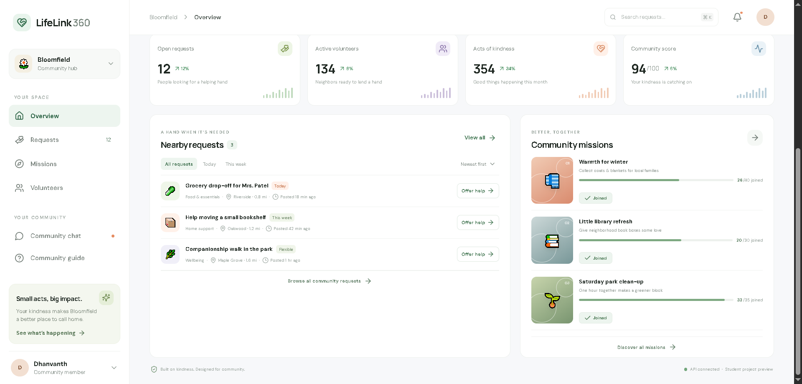
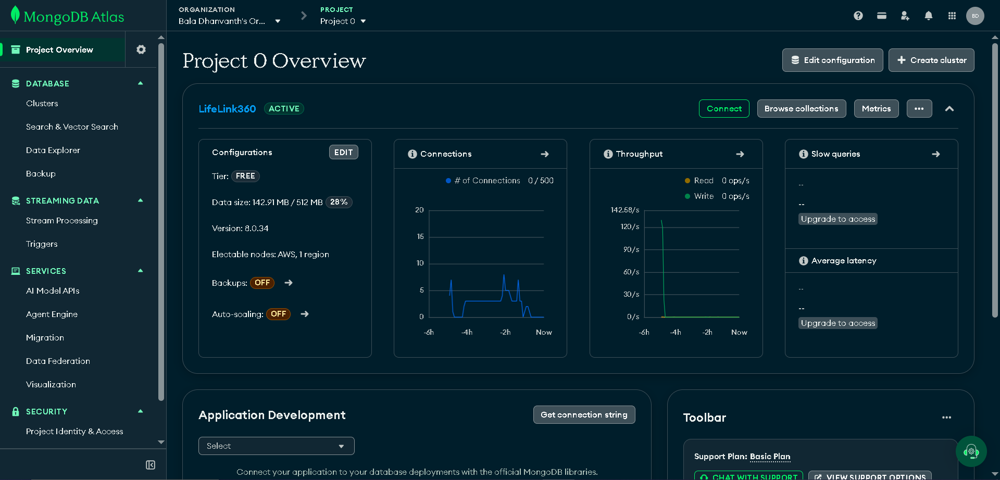

# LifeLink 360
**Live website:** [Open LifeLink 360](https://lifelink360-hvky0hkpc.vercel.app)

**Local demo:** [http://localhost:5173](http://localhost:5173) — available only on the computer running the frontend and API.


**LifeLink 360** is a responsive community-support web application created as a Web Technology academic project. It demonstrates how neighbors can share requests for everyday assistance, offer help, and take part in community missions.

> **Academic project demo only—not a real emergency response service.** LifeLink 360 does not provide emergency dispatch, live GPS tracking, payments, user authentication, or real volunteer matching. All sample counts and requests are illustrative. Do not enter sensitive personal information.

## Project links

- **Frontend:** [https://lifelink360-hvky0hkpc.vercel.app](https://lifelink360-hvky0hkpc.vercel.app)
- **API health:** [https://lifelink360.onrender.com/api/health](https://lifelink360.onrender.com/api/health)
- **Source code:** [GitHub repository](https://github.com/dhanvanthisalwaysafanofcristianoronaldo/LifeLink360)

The API health endpoint should return JSON with `"ok": true`. If the website shows **API offline**, follow the deployment configuration below; the API can be healthy while the frontend is configured with the wrong API URL or the API does not allow the frontend origin.

## Screenshots

### Community dashboard



### MongoDB Atlas cluster overview

This screenshot shows the Atlas cluster overview used by the demo; it is not a Data Explorer view of stored documents.



The validated-form screenshot will be added when available. Never include database credentials, connection strings, or real personal data in screenshots.


## Features

- Responsive community dashboard with impact statistics and a CSS 3D-style globe illustration.
- Assistance request submission with browser-side and server-side validation.
- Volunteer offers and community mission participation.
- Search, request filters, and interactive navigation previews.
- MongoDB Atlas persistence for hosted deployments, with a local JSON fallback for development.
- Accessible layout adjustments, reduced-motion support, and mobile-friendly styling.

## Technology

- React 18 and Vite
- Node.js HTTP API
- MongoDB Node.js driver and MongoDB Atlas (optional)
- Plain CSS and Lucide icons

## Run locally

Requirements: Node.js 20.19 or newer and npm.

1. Clone this repository and open a terminal in the project folder.
2. Install dependencies:

   ```powershell
   npm.cmd install
   ```

3. Open two terminals in the project folder. Start the API in the first:

   ```powershell
   npm.cmd run api
   ```

4. Start the frontend in the second:

   ```powershell
   npm.cmd run dev
   ```

5. Open the local URL printed by Vite (usually `http://localhost:5173`). Keep both terminals running while using the app.

The local API runs at `http://localhost:4000`. Without a MongoDB connection string, it stores demo state in `backend/data.json`, created from `backend/data.example.json` on first run. To build and preview the frontend, use `npm.cmd run build` and `npm.cmd run preview`.

## MongoDB Atlas configuration

MongoDB is optional for local development. To use Atlas:

1. Create an Atlas database user and allow the API host's IP address in Network Access.
2. Copy `.env.example` to `.env` in the project root.
3. Set `MONGODB_URI` to the Atlas connection string and keep it private.
4. Set `MONGODB_DB_NAME=lifelink360` and restart the API.

The API stores the dashboard document in the `appState` collection of the `lifelink360` database. It seeds the collection from `backend/data.example.json` when it is empty. The frontend never connects directly to MongoDB, so database credentials stay on the server.

## API endpoints

| Method | Endpoint | Purpose |
| --- | --- | --- |
| `GET` | `/api/health` | API and storage health status |
| `GET` | `/api/dashboard?participantId=...` | Dashboard statistics, requests, and missions |
| `POST` | `/api/requests` | Validate and submit a demo assistance request |
| `POST` | `/api/requests/:id/offers` | Offer help with a request |
| `POST` | `/api/missions/:slug/join` | Join a community mission |

## Deployment configuration

The frontend and API are deployed separately. Configure both services so the browser can call the API:

### Render API service

- Build command: `npm install`
- Start command: `npm run api`
- Health check path: `/api/health`
- Environment variables: `MONGODB_URI`, `MONGODB_DB_NAME=lifelink360`, and `FRONTEND_ORIGIN=https://lifelink360-hvky0hkpc.vercel.app`

`FRONTEND_ORIGIN` must match the exact public frontend origin (scheme and hostname, no trailing slash). If you use a different Vercel domain, update this value to that domain and restart/redeploy the Render service.

### Vercel frontend

Set this environment variable for the **Production** environment:

```text
VITE_API_BASE_URL=https://lifelink360.onrender.com
```

Do not add `/api` or a trailing slash to the value. Redeploy the frontend after changing it because Vite reads `VITE_` variables during the build. Never put `MONGODB_URI` in Vercel or any `VITE_` variable. Atlas Network Access must allow connections from the API host.

After deployment, verify `/api/health` returns `"ok": true` and `"storage": "mongodb"`, then check that the frontend dashboard loads the requests and missions. A healthy API endpoint alone does not confirm that browser CORS or the frontend API URL is configured correctly.

## Project structure

```text
src/
  App.jsx          Dashboard UI, interactions, and request form
  api.js           Frontend API client
  main.jsx         React entry point
  styles.css       Responsive design and accessibility styles
backend/
  server.js        API routes, validation, CORS, and storage setup
  data.example.json  Committed illustrative seed data
  data.json          Local mutable demo data (ignored by Git)
```

## Presentation and evaluation checklist

- Demonstrate the dashboard, request validation, volunteer offers, and mission participation.
- Explain the flow: React frontend → Node.js API → MongoDB Atlas (or local JSON fallback).
- Show the API health response and, if requested, the `appState` collection in Atlas. Hide connection credentials in screenshots.
- Confirm the public frontend can load API data before presenting the hosted link. Keep both local terminals running if you demonstrate the local version.

## GitHub

The repository contains the application source, README, lockfile, and sample data. Generated dependencies, build output, local environment files, and mutable local demo data are excluded. Never commit `.env`, database credentials, or real user data.
